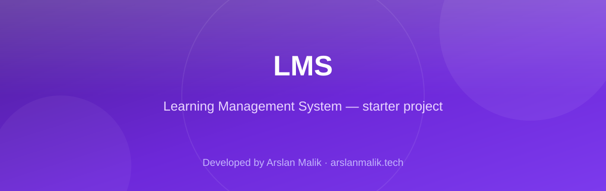
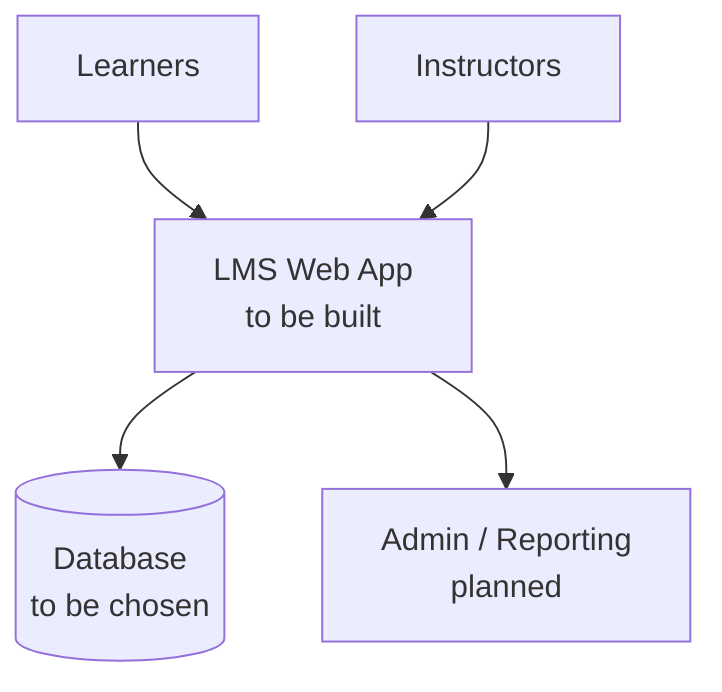

<p align="center">
  
</p>

<p align="center">
  
  
  
</p>

> **Developed by [Arslan Malik](https://github.com/arsalanmaalik461)**
> 📱 WhatsApp: [+92 300 8987448](https://wa.me/923008987448) · 🌐 Website: [arslanmalik.tech](https://arslanmalik.tech)

---

## 🌟 Executive Overview

**LMS** stands for *Learning Management System* — a starter repository set up as the home for a future learning-management application. At this stage the repository is a clean, empty canvas: no source code, dependencies, or project scaffolding have been added yet, so everything documented below describes the intended direction rather than existing features.

The plan for this project is a standard web-based LMS: course and lesson management, student enrollment, progress tracking, and instructor tooling. The exact tech stack (language, framework, database) will be decided when development begins, and this README will be updated to match the real implementation. If you are exploring this repo, watch it or come back later to see how it takes shape.

---

## 📑 Table of Contents

- [✨ Key Features & Highlights](#-key-features--highlights)
- [🖥️ Feature Showcase](#️-feature-showcase)
- [🏗️ System Architecture](#️-system-architecture)
- [🚀 Quickstart & Installation Guide](#-quickstart--installation-guide)
- [📂 Project Structure](#-project-structure)
- [🛡️ Security & Notes](#️-security--notes)

---

## ✨ Key Features & Highlights

| Feature | Description |
| :--- | :--- |
| 🧭 Starter Canvas | Empty, clean repo ready to be scaffolded — no legacy code to work around |
| 📚 Planned Scope | Course/lesson management, enrollment, and progress tracking for a learning platform |
| 🧹 Clean History | Fresh repository with a documented README from day one |

---

## 🖥️ Feature Showcase

> Nothing to showcase yet — the codebase is empty. This section will be filled in as modules land.

- **Roadmap:** initial scaffolding, data model, and authentication will be the first commits.
- **Contributions welcome:** open an issue or get in touch (contact links at the top) if you want to collaborate on this LMS.

---

## 🏗️ System Architecture



---

## 🚀 Quickstart & Installation Guide

### Prerequisites

- A working development machine
- Git installed

### Step-by-Step Installation

```bash
# Clone the repository
git clone https://github.com/arsalanmaalik461/LMS.git
cd LMS

# Project code is not yet committed — check back after the first release
git log --oneline
```

---

## 📂 Project Structure

```
LMS/
├── README.md               # This file
└── docs/
    └── assets/
        └── banner.svg      # Project banner
```

---

## 🛡️ Security & Notes

- This repository currently contains **no application code** — there is nothing deployed and no credentials or secrets to rotate.
- Before the first feature release: choose a license, add a `.gitignore`, and decide on the stack (framework, database, auth).
- Never commit real secrets (API keys, passwords, `.env` files) — use a secrets manager or environment variables.

---

<p align="center">
  <sub>Developed with ❤️ by <a href="https://github.com/arsalanmaalik461">Arslan Malik</a> · 📱 <a href="https://wa.me/923008987448">WhatsApp: +92 300 8987448</a> · 🌐 <a href="https://arslanmalik.tech">arslanmalik.tech</a></sub>
</p>
